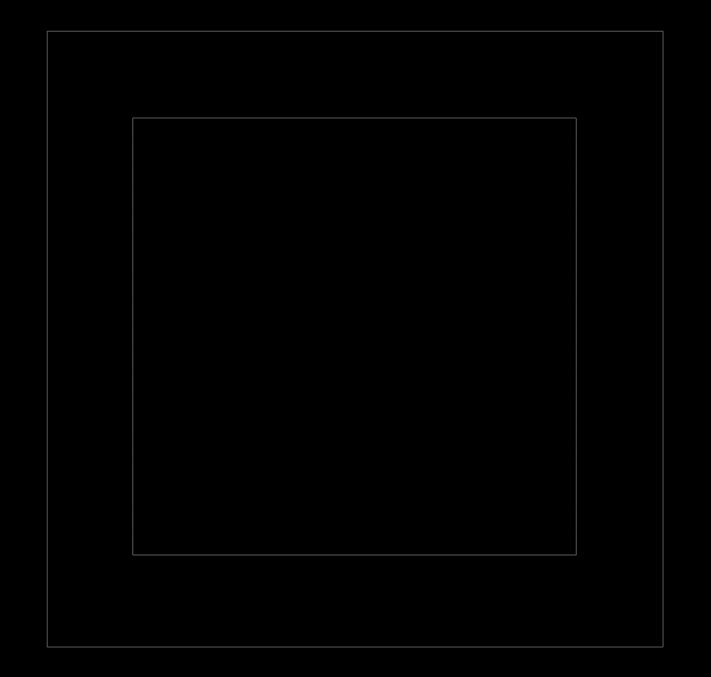
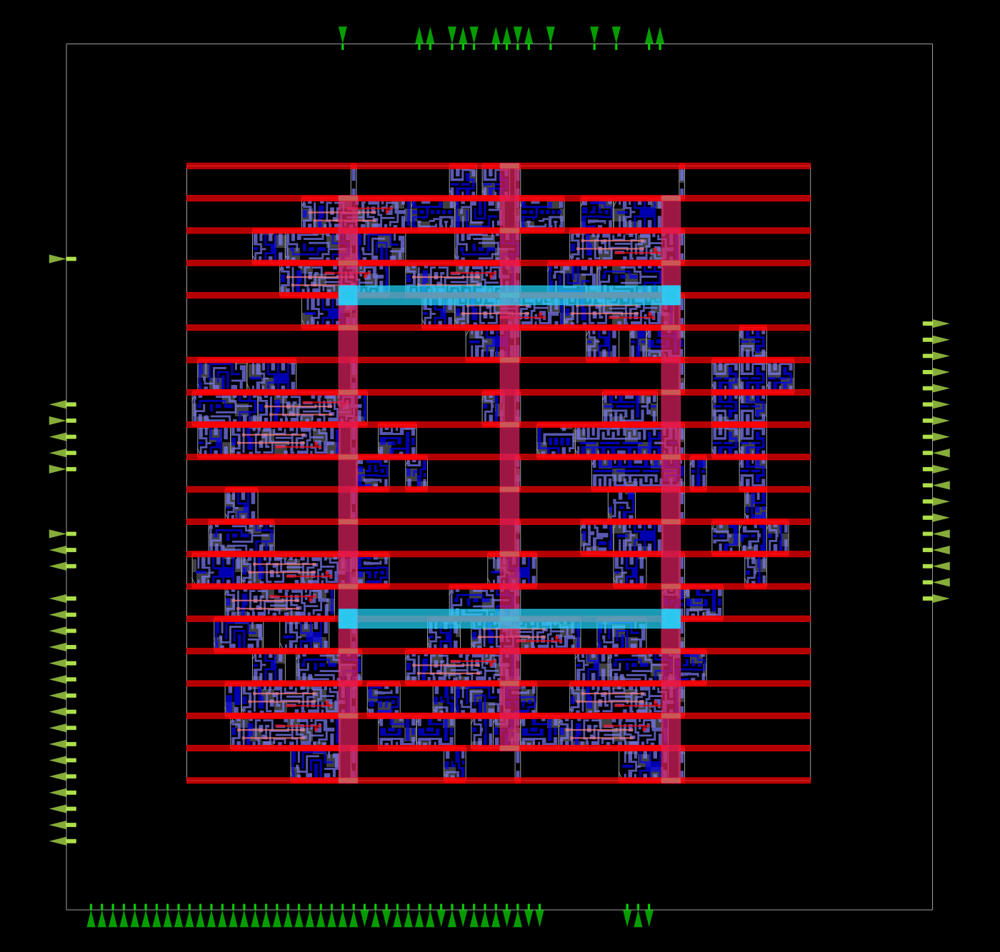
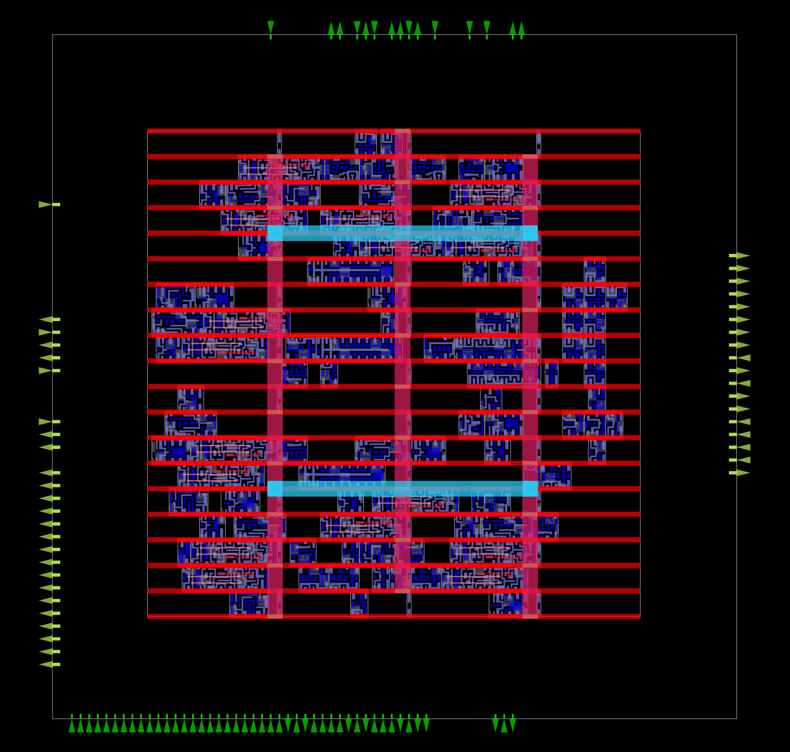
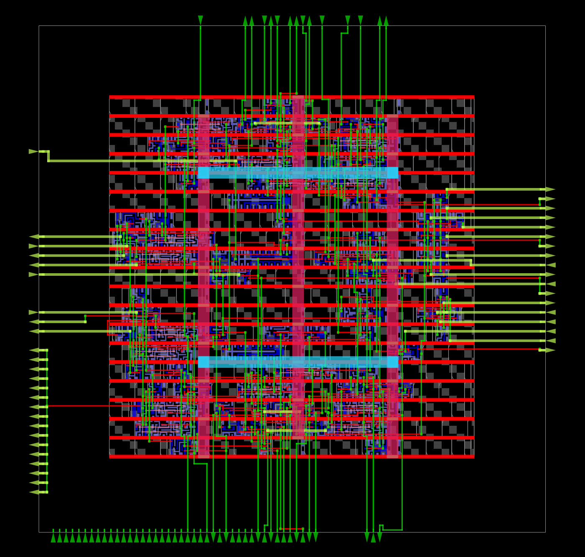
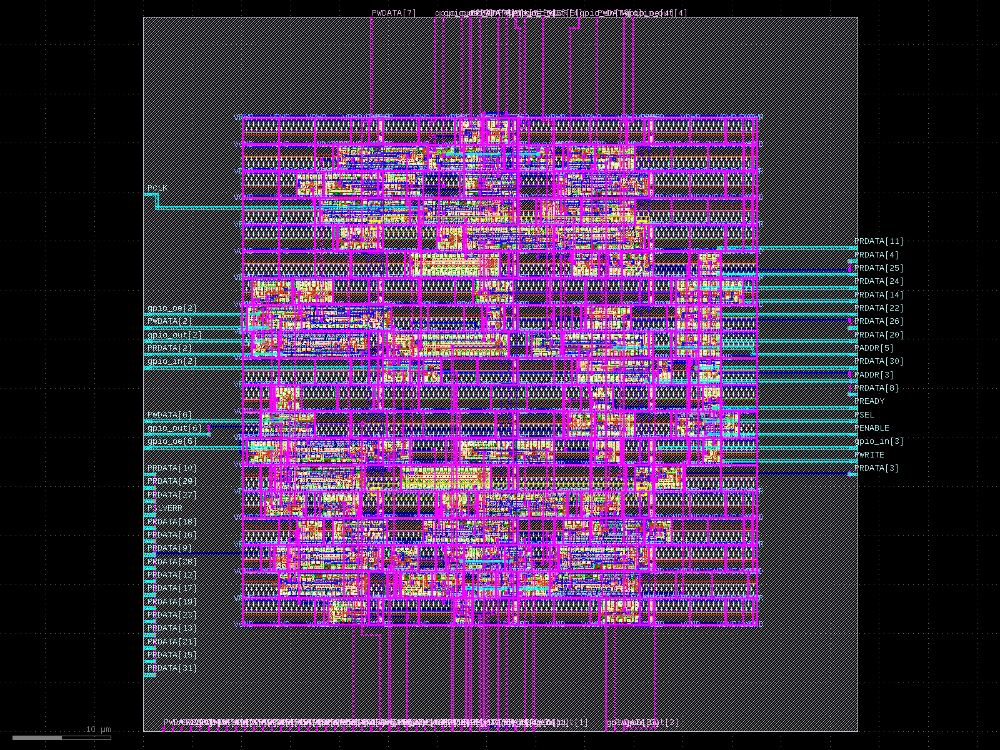

# APB GPIO - RTL to Routed Layout (Sky130 HD)

An APB slave GPIO block taken from RTL through synthesis, gate-level simulation,
multi-corner STA and OpenROAD place-and-route on the Sky130 HD library.

## Directory layout
| Folder | Contents |
|---|---|
| `rtl/` | RTL source |
| `tb/` | Testbench (`tb_apb_gpio.sv`) |
| `synthesis/` | Synthesized netlists (`apb_gpio_synth_D1000.v` used for PD) |
| `constraints/` | SDC (`apb_gpio.sdc`, 18 ns clock; 10 ns version kept as `.10ns.bak`) |
| `physical_design/` | OpenROAD scripts `01`-`11` and `results/` (ODB, DEF, logs) |
| `sta/`, `reports/` | STA reports and final PD reports |
| `sim/` | Simulation outputs and the patched Sky130 model |

## Verification
- RTL simulation: pass.
- Gate-level simulation of the synthesized netlist: 6/6 tests pass
  (GPIO_DATA = 0x55, GPIO_DIR = 0xF0, GPIO_STATUS = 0xA5, GPIO_ID = 0x4750494F).
- Post-route simulation of `apb_gpio_final.v`: 6/6 tests pass.
- The Sky130 functional model needs these flags:
  -DFUNCTIONAL -DUNIT_DELAY=#1
- Line 74452 of sky130_fd_sc_hd.v has a bare name after
  endif, which Icarus rejects. A patched copy is used
  instead (sim/sky130_fd_sc_hd_fixed.v).
  The PDK file itself is untouched.

## Physical design flow (OpenROAD)
- 01_floorplan.tcl: floorplan, 40% utilization
- 02_place.tcl: taps, power grid, pins, placement
  (sources tie_fix.tcl for the tie-low cell)
- 03_cts.tcl: clock tree and timing repair
- 04_route.tcl: global and detailed routing,
  fillers, antenna check
- 05, 06, 11: post-route STA and final reports

## Results (routed, 18 ns clock, about 55 MHz)
- Setup slack tt / ff / ss: +12.80 / +12.89 / +2.56 ns
- Hold slack tt / ff / ss: +0.39 / +0.30 / +1.73 ns
- TNS: 0 at all corners
- DRC / antenna violations: 0 / 0
- Cell area: 1234 um^2 (46% utilization)
- Total power (tt): 103 uW
  (sequential 42.6%, clock 40.0%, combinational 17.4%)
- Cell count: 388 including fill and tap cells
- Corners: tt_025C_1v80, ff_n40C_1v65, ss_n40C_1v28

## Issues found and fixed
1. LEF reading: read_lef -tech and -library left the
   cells unable to find site unithd. Fixed by reading
   both files with plain read_lef.
2. Routing tracks: added make_tracks before pin
   placement.
3. Slow-corner setup: at 10 ns the ss corner failed
   (WNS -5.50 ns, TNS -93.7 ns) on the PADDR decode
   path. The clock period was set to 18 ns. The I/O
   delay constraints were not changed.
4. Floating tie-low net: zero_ had no driver, so
   PSLVERR and 15 PRDATA bits floated (Z in the
   post-route simulation). Fixed by adding a
   sky130_fd_sc_hd__conb_1 cell (tie_fix.tcl).
   Post-route simulation then passed.

## Current signoff status
- Routed DEF, ODB, Verilog netlist, and GDSII files are available.
- The recorded detailed-routing log reports zero violations at its
  final routing iteration and zero antenna net/pin violations.
- Recorded timing results show positive setup and hold slack at the
  reported conditions; the main flow uses an 18 ns clock.
- LVS: netlists match in KLayout flat mode on `apb_gpio.gds`, with two changes made on copies (see Notes and limitations). This is not an unmodified-deck LVS-clean result.
- The old router DRC report files are empty; the independent KLayout DRC is in the Signoff DRC section.
- Parasitics are estimated from global routing, not fully extracted
  from the final layout.
- Power is vectorless (default activity), not based on simulation activity.
- Synthesis does not insert tie cells. The tie cell was added during
  physical design.

## Reproducing
Run 01_floorplan, 02_place, 03_cts and 04_route in
order with:
openroad -no_init -no_splash -exit physical_design/05_signoff_sta.tcl

## GDS note
A GDSII file was generated from the routed DEF using the
project's KLayout conversion script. LVS matches on this GDS with the
copy-level changes described above (see LVS reproduction); KLayout DRC is
in the Signoff DRC section.

## Final Status (2026-10-24)

| Check | Result |
|---|---|
| RTL / gate-level / post-route simulation | PASS (6/6 checks each) |
| Multi-corner STA, 18 ns clock (synthesis netlist, ideal clock) | TT setup +12.99 / hold +0.35 ns; FF +13.08 / +0.25; SS +3.69 / +2.79 |
| Post-route STA (propagated clock) | TT setup +12.80 / hold +0.39 ns; FF +12.89 / +0.30 ns; SS +2.56 / +1.73 ns |
| Router DRC | 14 violations in first iteration, 0 final |
| Antenna | 0 net, 0 pin violations |
| Signoff DRC (KLayout sky130A_mr, 2024.2.11) | 0 foundry-rule violations; 28 optional m2.x floating-met2 items, all labelled port pins |
| LVS (KLayout, flat) | Netlists match on apb_gpio.gds, with the two copy-level changes noted above |
| Area | 1234 um^2, 46% utilization |
| Power (total) | 103 uW (clock network 39.8%) |

### Notes and limitations
- Post-route STA (propagated clock, 18 ns), all corners pass: TT setup +12.80 / hold +0.39; FF (n40C, 1.65 V) +12.89 / +0.30; SS (n40C, 1.28 V) +2.56 / +1.73 ns. Post-CTS (pre-route, placement-based parasitics, TT): setup +12.84 / hold +0.38 ns, regenerated from 03_cts.odb (reports/pd_postcts_tt_precheck.log).
- Router DRC: 0 final violations. Independent KLayout DRC is in the Signoff DRC section.
- LVS: netlists match (KLayout, flat mode) on apb_gpio.gds and apb_gpio_powerfix_test.gds, but only with two changes made on copies:
  1. connect_implicit("*") disabled in sky130_noimplicit_test.lvs. In a flat run it merged all nets sharing a pin label (Y, X, A...).
  2. The unused conb_1 instance (X98) removed from the schematic copy, because the deck does not extract poly resistors.
- The earlier VNB must-connect error did not appear in these runs. Its cause was not identified.
- 16 internal nets matched with warnings (symmetric cell nodes).

## Signoff DRC
- Tool: KLayout 0.28.16 with the sky130A `sky130A_mr.drc` deck (release 2024.2.11), run on `physical_design/gds/apb_gpio.gds` with FEOL, BEOL and offgrid checks enabled.
- Result: 0 violations of foundry rules. The deck was verified with a deliberately narrow met1 control shape, which it flagged as `m1.1`.
- The optional floating-metal check (`floating_met=true`) reports 28 `m2.x` items. All 28 are met2 pin shapes on the bottom die edge, each carrying a port label (e.g. `PWDATA[29]`, `PADDR[0]`). This is not a foundry rule, and the items are intended top-level pins.
- Magic DRC was not used: the Magic 8.3.105 build on this VM cannot parse the PDK's sky130A tech file.

## LVS reproduction
- Result: "Congratulations! Netlists match." on `physical_design/gds/apb_gpio.gds` (log: `reports/pd_lvs_match.log`, database: `reports/pd_lvs_match.lvsdb`).
- Command (run from the project root, `PDK_ROOT` set to the PDK version folder, `PDK=sky130A`):
  `klayout -b -r physical_design/lvs/sky130_noimplicit_test.lvs -rd input=physical_design/gds/apb_gpio.gds -rd top_cell=apb_gpio -rd schematic=physical_design/lvs/apb_gpio_wrapper_noconb_test.spice -rd run_mode=flat -rd thr=6 -rd lvs_sub=VGND -rd convert_subckts=true -rd scale=true -rd schematic_simplify=true -rd report=<out>.lvsdb -rd target_netlist=<out>.cir`
- Without `schematic_simplify=true` the same inputs report a mismatch.
- The match depends on the two copy-level changes listed above: implicit connections disabled in the deck copy, and the unused `conb_1` (X98) removed from the reference.

## Layout images

Screenshots of each physical-design stage, generated from the ODB files in `physical_design/results/` and the final GDS.

### Floorplan

### Placement

### Clock tree synthesis

### Routing

### Final layout (GDSII, viewed in KLayout)

## Project Video
https://drive.google.com/file/d/1eNLlKi2RSJSW8lob519OwSTwFQD5fyZu/view?usp=sharing
